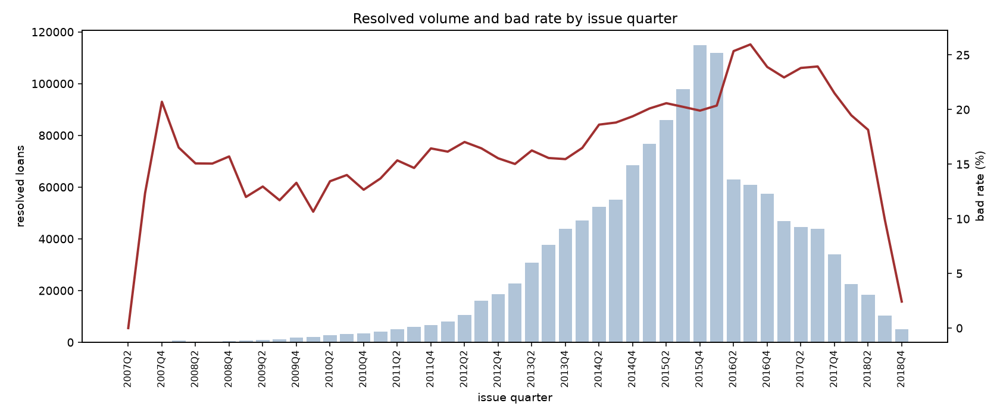

# 01 - Data profile

Generated by `python scripts/profile_data.py`. Every figure below is
reproduced by rerunning that command against the raw extract.

## Load

```
source                  accepted_2007_to_2018Q4.csv
columns read            151
chunks                  12
rows kept               2,260,668
unparsable rows dropped 33
peak chunk memory       139.5 MB
```

The dropped rows are not loans. The extract is sixteen LendingClub
exports concatenated, each of which kept its own two-line
"Total amount funded in policy code N" footer, plus one
"Loans that do not meet the credit policy" divider. They sit inside the
data rather than after it, and every one carries nulls in all 150
remaining fields.

## Target (D1)

```
rows in                 2,260,668
  good (0)              1,076,751
  bad (1)               268,599
  unresolved, excluded  912,569 (40.4% of rows in)
  policy failures       2,749
  missing status        0
rows out                1,345,350
bad rate                19.96%
bad rate if unresolved  11.90%
  were counted good     (understates by 8.07% points)
```

| Status | Rows | Treatment |
|---|---:|---|
| Fully Paid | 1,076,751 | good (0) |
| Current | 878,317 | excluded, unresolved |
| Charged Off | 268,559 | bad (1) |
| Late (31-120 days) | 21,467 | excluded, unresolved |
| In Grace Period | 8,436 | excluded, unresolved |
| Late (16-30 days) | 4,349 | excluded, unresolved |
| Does not meet the credit policy. Status:Fully Paid | 1,988 | excluded, separate population |
| Does not meet the credit policy. Status:Charged Off | 761 | excluded, separate population |
| Default | 40 | bad (1) |

- Rows in: **2,260,668**
- Rows out (resolved): **1,345,350**
- Bad rate: **19.96%**
- Bad rate if unresolved loans were counted as good: **11.90%** (8.07% points lower)

## Volume by year (D3)

`share_from_end` is the fraction of resolved loans issued in that year
or later. D3 asks for a cutoff leaving roughly 20-25% of the resolved
population in the holdout window, so the candidate cutoff is the year
whose `share_from_end` lands in that band.

| Year | Resolved loans | Bad | Bad rate | Share | Share from end |
|---|---:|---:|---:|---:|---:|
| 2007 | 251 | 45 | 17.93% | 0.02% | 100.00% |
| 2008 | 1,562 | 247 | 15.81% | 0.12% | 99.98% |
| 2009 | 4,716 | 594 | 12.60% | 0.35% | 99.87% |
| 2010 | 11,536 | 1,487 | 12.89% | 0.86% | 99.51% |
| 2011 | 21,721 | 3,297 | 15.18% | 1.61% | 98.66% |
| 2012 | 53,367 | 8,644 | 16.20% | 3.97% | 97.04% |
| 2013 | 134,804 | 21,024 | 15.60% | 10.02% | 93.08% |
| 2014 | 223,103 | 41,162 | 18.45% | 16.58% | 83.06% |
| 2015 | 375,546 | 75,804 | 20.19% | 27.91% | 66.47% |
| 2016 | 293,105 | 68,252 | 23.29% | 21.79% | 38.56% |
| 2017 | 169,321 | 39,169 | 23.13% | 12.59% | 16.77% |
| 2018 | 56,318 | 8,874 | 15.76% | 4.19% | 4.19% |

No calendar year lands in the band. Everything from 2017 onward is
16.8% of resolved loans and everything from 2016 onward is
38.6%, so the cutoff has to sit inside a year and the
choice is only visible quarter by quarter:

| Cutoff quarter | Holdout loans | Holdout share | Bad rate in quarter |
|---|---:|---:|---:|
| 2016Q2 | 406,810 | 30.24% | 25.35% |
| 2016Q3 | 343,861 | 25.56% | 25.96% |
| 2016Q4 | 282,970 | 21.03% | 23.90% |
| 2017Q1 | 225,639 | 16.77% | 22.94% |

`cutoff_date` in `config/config.yaml` stays null until one of these is
chosen. Reading the table: setting the cutoff to a quarter puts that
quarter and everything after it in the holdout.



The bad rate moves across the sample. That is why D5 measures stability
with PSI by quarter rather than assuming the population holds still.

## Columns (D2 worksheet)

All 151 columns are listed in
[`column_profile.csv`](column_profile.csv) with an empty
`availability` column. Filling it in is the leakage audit: each column
is marked `app` if the value was known when the application was
decided, `post` if it was generated afterwards, and `?` if it needs a
decision. A whitelist built this way fails loudly on the columns nobody
thought about; a blacklist fails silently.

Nothing downstream may use a column until it carries a label.
